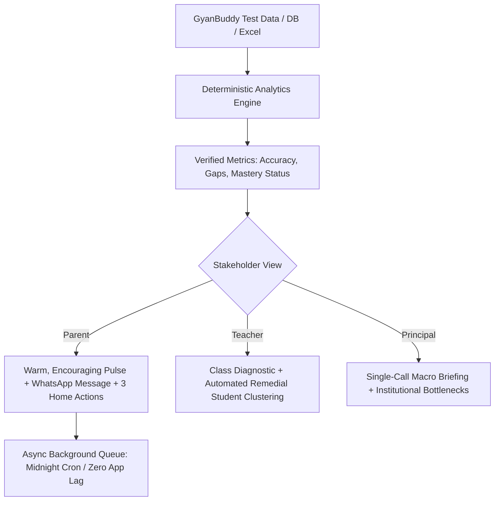

# 📚 GyanBuddy AI Insight Engine

## Django + Flutter email integration

Open **[Progress Dashboard](http://localhost:8000/progress)** while the local app is running. It shows persistent upload history, report processing, per-student report previews and email status. Local mode analyses current uploaded marks offline; email delivery becomes available in the connected Django dashboard at `/api/insights/dashboard/`.

The installable `gyanbuddy_insights` Django app generates reports after marks are saved and queues grouped, role-specific emails with one publish action. See [the developer guide](docs/DJANGO_INTEGRATION.md) for setup, the marks-save hook, API contract, recipient adapter, Celery, SMTP and Flutter button example.

The standalone dashboard now includes an **Email Integration** tab with the developer package. It does not send mail itself. GyanBuddy's real Django models and mail account still need to be connected.

Build the handoff ZIP with `python scripts/build_integration_package.py`. Test the integration with `python -m django test integration_tests --settings=integration_tests.settings` after installing `requirements-integration.txt`.

## Current development checkpoint

See [CHECKPOINT.md](CHECKPOINT.md) for verified behavior and remaining work.

CSV and Excel imports require student name, score and maximum score columns (common aliases such as `Name`, `Marks` and `Out of` are accepted). Every populated row is validated before replacement. Decimal marks and leading-zero text IDs are preserved. Supply unique student IDs; without them, records are grouped by class, section and roll number or name, with a warning about namesakes. Missing class/subject metadata is marked unspecified.

The teacher selector lists the uploaded class/section/subject combinations. Parent and principal views use recorded results, and offline reports no longer insert sample names or topics.

Install runtime dependencies with `python -m pip install -r requirements.txt`. For regression checks, install `requirements-dev.txt` and run `python -m unittest discover -s tests -v`.

The historical cost and server-load claims below have not been revalidated; treat them as prototype assumptions pending the follow-up work in the checkpoint.

An automated, hyper-cost-efficient academic intelligence system designed for **GyanBuddy School Management System**.

It transforms raw test results into tailored, actionable insights for **Parents**, **Teachers**, and **Principals** using modern Cloud AI (Google Gemini 2.5 Flash / OpenAI GPT-4o-mini) with near-zero server pressure and minimal API cost.

---

## ⚡ The Breakthrough: Cost & Server Load Analysis

Many developers worry about high API bills or server crashes when scaling to thousands of students. Here is the actual production math:

| Factor | Local Self-Hosted LLM (e.g. Qwen) | Cloud API (Gemini 2.5 Flash) | Pure Rule-Based Engine |
| :--- | :--- | :--- | :--- |
| **Server Pressure** | **Extreme**: 100% CPU lock, crashes app or requires expensive GPU | **Zero**: Heavy lifting handled in cloud; async worker uses &lt; 1% CPU | **Near Zero**: Simple loops |
| **Monthly Cost (1,500 Students)** | **$40 – $100+/mo** (VPS GPU hosting cost) | **$0.12 USD (₹ 10.38 INR)** per month! | **$0** (Free) |
| **Cost Per Student** | ~₹ 4.50 INR / student | **₹ 0.007 INR** (fractions of a single paisa!) | ₹ 0 |
| **Insight Quality** | Requires tuning & VRAM management | **Empathetic, clear, personalized & actionable** | Rigid, repetitive, robotic |

> **Conclusion**: Calling **Gemini 2.5 Flash** costs only **₹ 10.38 / month for 1,500 students** while putting **zero compute pressure** on GyanBuddy's main servers.

---

## 🏗️ 3-Tier Multi-Stakeholder Intelligence



1. **For Parents**:
   - Celebrates strengths first (e.g., Mathematics - Linear Equations: 80%).
   - Empathetically pinpoints gaps with clear context (e.g., *Abhishek struggled with Gravitation numerical problems: 2/10 correct*).
   - Generates 3 practical, realistic home action steps (15 mins daily formula review, practice questions on GyanBuddy app).
   - Instant 1-click **WhatsApp message draft** formatted with emojis.

2. **For Teachers**:
   - Synthesizes Class 9-A Science diagnostics.
   - **Automated Remedial Clusters**: Groups students who failed the same concept (e.g., *Gravitation Remedial Group: Abhishek Sharma, Priya Verma, Rohan Gupta, Aryan Singh, Kavita Nair*).
   - Suggests a 15-minute targeted in-class intervention and scaffolding homework worksheet.
   - Pairs high-performing students with struggling students for peer study.

3. **For Principals**:
   - Macro Grade/School health score (e.g. 61/100).
   - Curriculum bottleneck alerts (e.g. Science Class 9 dipped to 46.7%).
   - Actionable administrative suggestions (scheduling remedial period, teacher faculty support).

---

## 🚀 Quickstart Guide

### 1. Configure an AI provider
Store credentials in the server's `.env` file (excluded from Git):
```dotenv
INSIGHTS_PROVIDER=openai
OPENAI_API_KEY=your_openai_api_key
OPENAI_MODEL=gpt-4o-mini
```
Restart the server after changing configuration, then open [Report progress](http://localhost:8000/progress) and click **Analyse uploaded marks**. New reports show their provider and model. The key is never sent to the browser or Flutter app.

For Gemini, use `INSIGHTS_PROVIDER=gemini`, `GEMINI_API_KEY` and `GEMINI_MODEL`. For offline reports, use `INSIGHTS_PROVIDER=rules`. Without an explicit provider, the progress preview selects OpenAI when its key is present, otherwise offline rules. Existing saved reports keep their original source. OpenAI failures in the progress/Django workflow are shown as failures, not replaced by offline reports.

For the Flutter/Django integration, see [provider settings](docs/DJANGO_INTEGRATION.md#openai-or-gemini-configuration). Django settings and worker environment must be configured in the host project.

### 2. Run the Application
The environment is pre-configured. Start the server directly:
```bash
python app.py
```
Open **[http://localhost:8000](http://localhost:8000)** in your browser.

---

## 📁 Repository Structure

```
c:\AI INSIGHT\
├── app.py                      # FastAPI server & REST API
├── requirements.txt            # Python dependencies
├── .env.example                # Sample environment variables
├── data/
│   ├── students_test_data.csv  # Realistic GyanBuddy test records (Abhishek, Gravitation, etc.)
│   └── students_test_data.json
├── engine/
│   ├── analytics.py            # Deterministic math engine (Accuracy, Gaps, Remedial Clusters)
│   ├── ai_generator.py         # Cloud API client (Gemini Flash & OpenAI with Smart Fallback)
│   ├── batch_worker.py         # Rate-limited async batch worker (Zero server strain)
│   └── prompt_templates.py     # Cost-minimized prompt engineering for Parent, Teacher, Principal
└── static/
    ├── index.html              # Sleek interactive dashboard UI
    ├── css/styles.css          # Modern dark-mode glassmorphism design system
    └── js/app.js               # Client application logic & WhatsApp integration
```

---

## 🔗 REST API Endpoints

- `GET /api/status` - Current AI provider status and student statistics
- `GET /api/students` - Full student roster with overall accuracy % and critical gap count
- `GET /api/reports/parent/{student_id}` - Generate parent insight report (e.g., `STU101` for Abhishek)
- `GET /api/reports/teacher/{class}/{section}/{subject}` - Generate teacher cluster diagnostic
- `GET /api/reports/principal` - Generate school executive briefing
- `GET /api/cost-calculator?students=1500&frequency=monthly` - Dynamic token & cost simulator
- `POST /api/batch/run` - Launch asynchronous background batch job
- `POST /api/settings/keys` - Update API credentials live without restart

### Database-to-email integration
The Django module supports one-click analysis and sending through `POST /api/insights/email-all-reports/` with a reporting/exam reference. The host access adapter reads marks and verified parent/teacher/principal email relationships directly from GyanBuddy's database. Sending is queued automatically after analysis succeeds. A Gmail SMTP settings helper and Flutter API method are included; see [database and Gmail setup](docs/DJANGO_INTEGRATION.md#one-click-database-marks-to-recipient-emails). Apply the new migrations when updating the module. Host database mapping, sender credentials and live deployment are still required.
